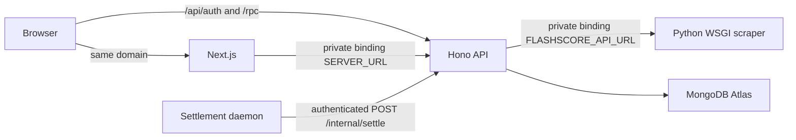

# Vercel deployment

This repository prepares one Vercel project for the frontend, API, private Python
scraper and settlement daemon. MongoDB Atlas stores accounts, wallets and bets.
Preparation is not proof of a successful cloud deployment: verify the release
checks below before using the public site.



The scraper has no public rewrite. The API exports its Hono app without opening
a listener on Vercel. Local Node/Docker execution still opens a port and runs the
local settlement loop. On Vercel, only the dedicated daemon schedules settlement;
an in-function `setInterval` is not relied on after requests finish.

The Hono service builds from `src/index.ts` with `outputDirectory: "."` to keep
workspace dependency paths intact. The hosted API validates its runtime variables
directly, without requiring the Varlock CLI in a function. Local execution retains
Varlock loading; build commands explicitly generate its typed environment modules.

## Account and plan

- Use the existing `gold-bet-money365` Vercel project linked to the repository.
- Keep the project Root Directory at the repository root, not `apps/web`.
  Vercel builds the three roots declared in `vercel.json` separately.
- Services and Daemons are beta platform features. Verify they are available
  in the target team and that the project configuration validates during build.
- The daemon is currently disabled (`cdg1: 0`) for the free test deployment.
  Users can click **Refresh results** in bet history to settle their own completed
  bets, up to five checks per minute. Unattended settlement is not enabled.
  To enable continuous processing after choosing an appropriate plan, set
  `cdg1: 1`; that runs one 1-GiB instance.
  Hobby only provides 10 vCPU-hours per month for daemons, approximately ten
  hours for this instance. It then stops. Use Pro for continuous operation;
  confirm the subscription and usage costs before purchasing. Hobby is for
  personal, non-commercial use. A trial deployment is not 24/7 production.
- Connect MongoDB Atlas through the project's Storage integration. Creating
  the integration requires accepting its terms and account-data sharing.
  Review the database plan separately. Free clusters are useful for testing;
  choose a plan with the backups, capacity and recovery guarantees needed for
  real account balances before a production launch.

## Environment variables

Configure these privately for Production in Vercel. For this existing project,
the public origin is `https://gold-bet-money365.vercel.app`; replace all three
origin variables together if a custom domain becomes canonical.

| Variable | Value / source |
| --- | --- |
| `NODE_ENV` | `production` |
| `NEXT_PUBLIC_SERVER_URL` | `https://gold-bet-money365.vercel.app` |
| `BETTER_AUTH_URL` | `https://gold-bet-money365.vercel.app` |
| `CORS_ORIGIN` | `https://gold-bet-money365.vercel.app` |
| `DATABASE_URL` | Atlas connection URI with the intended database name; never localhost |
| `BETTER_AUTH_SECRET` | New random secret of at least 32 characters; do not reuse development values |
| `SETTLEMENT_WORKER_SECRET` | Required only when enabling the daemon: separate random secret of at least 32 characters |

`SERVER_URL` and `FLASHSCORE_API_URL` are generated by Vercel service bindings at
runtime. Do not manually override them with localhost, a preview domain or the
production public URL. Only `NEXT_PUBLIC_SERVER_URL` is public. Never prefix
database credentials, the worker credential or auth secrets with `NEXT_PUBLIC_`.
Save `NEXT_PUBLIC_SERVER_URL` as Vercel **Config**, not a write-only Secret;
Vercel rejects edits to public-prefixed variables stored as Secrets. Verify the
deployed browser bundle uses the public domain rather than localhost.

The Atlas integration may create a variable called `MONGODB_URI`. The app expects
`DATABASE_URL`: the server schema uses it automatically when DATABASE_URL is not explicitly set. Use a database
user restricted to the application's database and the integration's supported
network access configuration. Do not expose the local Windows MongoDB service.

Use a separate test database and environment values for Preview deployments.
Daemons do not run in Preview; preview betting must not use production balances.
The repository's ignore files exclude local credentials from source uploads.

## Initial admin and existing data

For a new, empty Atlas database, run the existing bootstrap command once from
`apps/server` using the production `DATABASE_URL`, public URLs, auth secret and
private `INITIAL_ADMIN_NAME`, `INITIAL_ADMIN_PHONE`, `INITIAL_ADMIN_PASSWORD`
environment values:

```sh
pnpm auth:bootstrap
```

Run this as an operator task, never as an HTTP endpoint or every cold start.
The script also supports the existing local `.env.admin.local` file when no
password is supplied through the environment. Bootstrap refuses to promote
an existing non-admin and does not reset existing passwords. Keep initial
passwords out of Vercel's permanent application environment.

An empty cloud database does not contain local accounts, credits or bets.
Migration requires a consistent backup of the existing database and an explicit
cutover, including all wallet ledger and bet records. Do not copy just balances
or run local and cloud settlement against divergent copies of the same bets.
No local financial records are automatically uploaded by this configuration.

## Release verification

1. Build the current source with Node 24 and the repository's pinned pnpm version.
2. Confirm the Python service builds with Python 3.12 and its pinned dependencies.
3. Verify `GET /health/ready` returns `{ "ok": true }`. It checks replica-set or
   sharded MongoDB connectivity needed for wallet transactions.
4. Verify an unauthenticated `POST /internal/settle` returns 401. With the daemon
   disabled, verify the user's **Refresh results** action. If enabled later,
   the daemon must report successful ticks in Vercel Logs.
5. Verify login, refresh, protected dashboard routes and bet history on the
   actual public domain. Secure HttpOnly session cookies must survive navigation.
6. Verify live scores and odds through the API from the deployment region, and
   that the Python service has no public route. No fake prices/results are used.
7. Use a separate test environment to verify a stake debit and final payout,
   including retries. Do not submit financial test bets using real balances.
8. Confirm backups, operator access and the recovery process for pending bets.

Local regression commands (temporary databases are created and dropped):

```powershell
$env:RUN_AUTH_INTEGRATION='1'
pnpm --filter server exec tsx --test src/deployment.test.ts src/deployment.integration.test.ts ../../packages/api/src/betting.integration.test.ts
```

References: [Services](https://vercel.com/docs/services),
[service bindings](https://vercel.com/docs/services/bindings),
[Python runtime](https://vercel.com/docs/functions/runtimes/python),
[Daemons](https://vercel.com/docs/daemons),
[daemon limits](https://vercel.com/docs/daemons/limits),
[Atlas cluster setup](https://www.mongodb.com/docs/atlas/tutorial/deploy-free-tier-cluster/).
